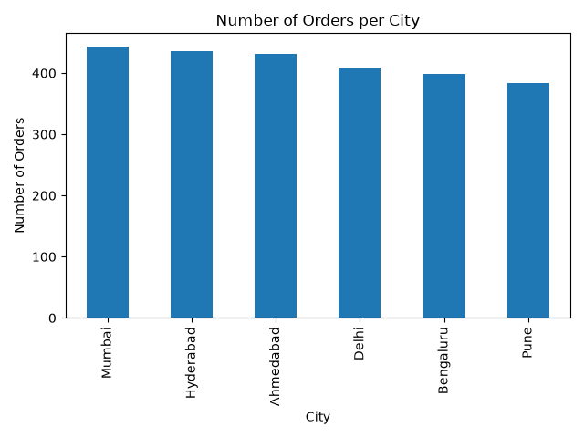
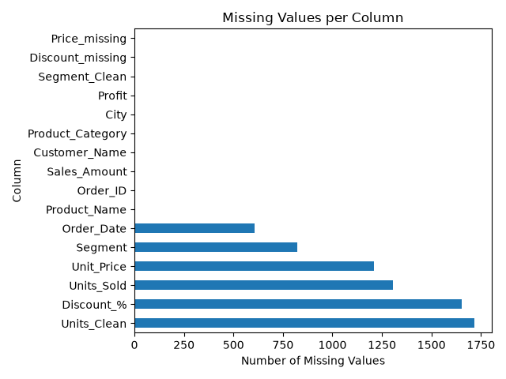
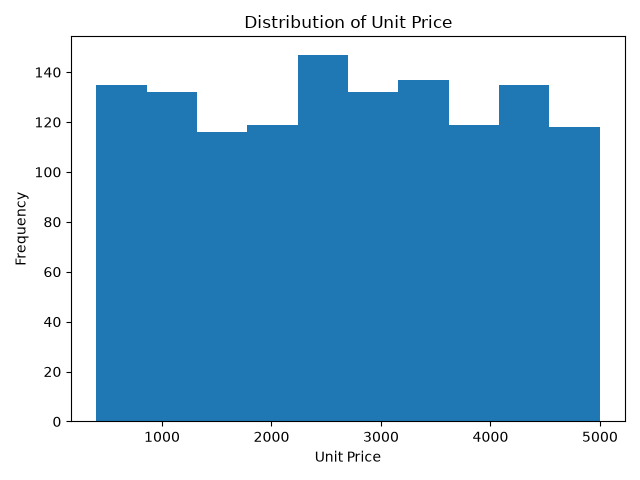
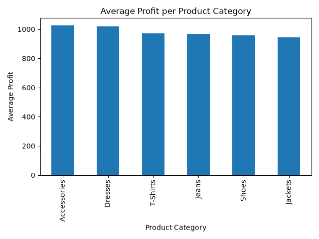

# Snitch Clothing Sales: Data Cleaning

A data cleaning project in Python (pandas). The goal is to turn a messy sales file into a clean, documented dataset that is ready for EDA.

## Dataset

- **Source:** Kaggle, "Snitch Clothing Sales" by nayakganesh007 [https://www.kaggle.com/datasets/nayakganesh007/snitch-clothing-sales]
- **License:** [License CC0: Public Domain](https://creativecommons.org/publicdomain/zero/1.0/)
- **Size:** 2,500 rows x 12 columns
- **Columns:** Order_ID, Customer_Name, Product_Category, Product_Name, Units_Sold, Unit_Price, Discount_%, Sales_Amount, Order_Date, City, Segment, Profit
- **- **Synthetic (stated by the author, and consistent with my checks)** Evidence:
  - Units_Sold is almost evenly spread from -2 to 6 (117 to 144 rows per value).
  - Product_Category has 6 values with 410 to 443 rows each.
  - Profit has no correlation with Sales_Amount or Units_Sold (about 0.0).
  - No formula links the columns: Sales_Amount does not equal Units_Sold x Unit_Price, with or without Discount_%.

Because the data is synthetic, business conclusions from it are not reliable. The project is about cleaning method, not insight.

## Problems found

| Column | Problem | Count |
|---|---|---|
| City | Spelling variants ("Hyd", "Hyderbad", "Bangalore"), plus spaces and capitals | not counted (6 clean values after fixing)  |
| Order_Date | 3 mixed formats (DD-MM-YYYY, YYYY-MM-DD, YYYY/MM/DD) | all rows |
| Order_Date | Missing | 606 (24.2%) |
| Units_Sold | Missing | 1,306 (52.2%) |
| Units_Sold | Zero or negative (invalid quantity): 129 zero, 283 negative | 412 of 1,194 present values (34.5%) |
| Unit_Price | Missing | 1,210 (48.4%) |
| Discount_% | Missing | 1,651 (66.0%) |
| Segment | Missing | 821 (32.8%) |
| Sales_Amount | Zero | 2,321 (92.8%) |
| Sales_Amount | Negative | 70 (2.8%) |
| Profit | Negative | 636 (25.4%) |

Checked and clean: Customer_Name (2,458 different names), Product_Category (6 values), Product_Name (24 values), no duplicate rows when Order_ID is ignored (0).

## What I did

| Column | Action | Result |
|---|---|---|
| City | strip, title case, replaced variants | 6 values: Delhi, Ahmedabad, Mumbai, Bengaluru, Hyderabad, Pune |
| Order_Date | `pd.to_datetime(format="mixed", dayfirst=True, errors="coerce")` | real dates, 606 missing kept, range 2023-02-09 to 2025-12-07 |
| Units_Sold | Zero and negative values turned into NaN in a new column `Units_Clean`; not filled | 1,718 missing (68.7%) |
| Segment | Missing labelled "Unknown" in `Segment_Clean` | B2B 844, B2C 835, Unknown 821 |
| Discount_% | Kept as NaN, flag column `Discount_missing` | 1,651 flagged |
| Unit_Price | Kept as NaN, flag column `Price_missing` | 1,210 flagged |

Original columns are never overwritten. Every cleaned version is a new column, so the raw values can always be compared.

## Assumptions and limits

- **Day-first dates.** Dates like 03-04-2024 were read as 3 April. If the source used month-first, those dates are wrong. A first attempt without `format="mixed"` lost 1,266 dates, which is why mixed parsing was used.
- **Missing values were not filled with the mean or median.** Between 48% and 69% of these columns are missing, so any fill would invent most of the column. Flag columns record what was missing.
- **No formula could recover missing values.** The tests on Sales_Amount, Units_Sold, Unit_Price and Discount_% all failed.
- **Zero and negative Units_Sold may be returns,** but nothing in the data confirms this, so they were treated as invalid.
- **Sales_Amount is 0 in 92.8% of rows,** so it should not be used for sales analysis in this dataset.

## Files

- `data/raw_data.csv`: original file, never modified
- `clean-data.py`: the cleaning script
- `data/cleaned_data.csv`: output, 2,500 rows x 16 columns (the 12 originals plus Units_Clean, Segment_Clean, Discount_missing, Price_missing)

When loading the cleaned file, use `pd.read_csv("data/cleaned_data.csv", parse_dates=["Order_Date"])` so dates come back as dates.

## Exploratory Data Analysis

The file `cleaned_data.csv` contains 2,500 rows and 16 columns. I analysed this dataset using the Python script `eda_all.py`, and according to the dataset's author, the dataset is synthetic (artificially generated).

### Orders per city

Mumbai has the highest number of orders (443), followed by Hyderabad (436) and Ahmedabad (431), while Pune has the lowest (383). The difference between the highest and lowest is only 60 orders, showing a relatively even distribution across the six cities. This even spread is consistent with synthetic data and does not necessarily represent real customer demand.

### Missing values per column

`Units_Clean` has the most missing values (1,718 or 68.7%), followed by `Discount_%` (1,651 or 66.0%) and `Units_Sold` (1,306 or 52.2%). The additional 412 missing values in `Units_Clean` come from zero and negative quantities that were converted to missing values. We retained the missing values rather than filling them with made-up numbers, which means some analyses may have fewer usable observations.

### Unit price distribution

The histogram shows a relatively flat distribution, with each bin containing approximately 115 to 147 observations. Unit prices are spread across the range of 400.2 to 4,998.9, with a mean of 2,691.7 and a median of 2,686.0. This nearly uniform spread is consistent with artificially generated data rather than a naturally concentrated distribution of real-world product prices.

### Average profit per product category

Accessories have the highest average profit (1,025.3), while Jackets have the lowest (943.4), with a difference of 81.9. However, the standard deviation ranges from 1,140 to 1,178 across categories, indicating considerable variation in individual profit values. Therefore, we cannot conclude that Accessories genuinely perform better without further statistical testing.

## Limitations

- **Synthetic data:** The dataset is artificially generated, so its patterns may not accurately represent real-world sales, customer behaviour, or business performance.
- **Missing values:** `Order_Date` contains 606 missing values (24.2%). Additionally, `Units_Clean` has 1,718 missing values (68.7%), and `Discount_%` has 1,651 missing values (66.0%). These missing values limit the reliability of some analyses.
- **Sales and profit limitations:** `Sales_Amount` contains 2,321 zero values (92.8%) and 70 negative values, which may affect sales and profit analysis. The 81.9 average profit gap between Accessories and Jackets does not establish a statistically significant difference in their performance.